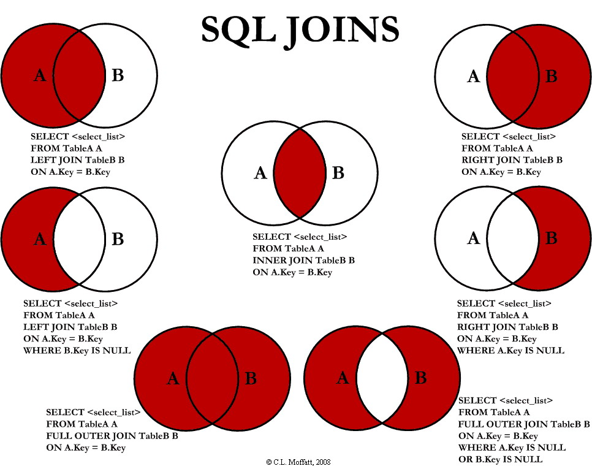

# SQL Joins Visualization

> ⚠️ **Disclaimer**: Ce code a été généré par Cursor et n'est pas du tout optimal. Il peut servir de base, mais n'hésite pas à l'adapter et l'améliorer. Amuse-toi bien 🙂

An interactive Electron application for visualizing and experimenting with different types of SQL JOIN operations. This educational tool helps users understand SQL joins through interactive tables, real-time results, Venn diagrams, and generated SQL queries.



## 🚀 Quick Start

### Prerequisites
- [Node.js](https://nodejs.org/) (v14 or higher)
- npm (comes with Node.js)

### Installation & Launch

```bash
# Clone the repository
git clone <repository-url>
cd jointures-sql

# Install dependencies
npm install

# Start the application
npm start
```

## 📋 Features

### Core Functionality
- **Interactive Tables**: Modify data in Tables A and B with editable cells
- **Real-time Joins**: See join results update instantly as you modify data
- **Visual Diagrams**: Venn diagrams illustrating each join type
- **SQL Generation**: View the corresponding SQL query for each join operation
- **Data Management**: Add/remove rows and reset to default sample data

### Supported Join Types
1. **INNER JOIN** - Returns only matching records from both tables
2. **LEFT JOIN** - Returns all records from left table and matching from right
3. **RIGHT JOIN** - Returns all records from right table and matching from left
4. **FULL OUTER JOIN** - Returns all records from both tables
5. **LEFT JOIN WHERE B.key IS NULL** - Returns only records from left table with no match in right
6. **RIGHT JOIN WHERE A.key IS NULL** - Returns only records from right table with no match in left

## 🏗️ Project Structure

```
jointures-sql/
├── main.js              # Electron main process
├── index.html           # Application UI layout
├── renderer.js          # Frontend logic and join algorithms
├── style.css            # Application styling
├── package.json         # Project configuration
├── images/
│   └── sql_joins.jpg    # Join types reference diagram
└── README.md           # This documentation
```

## 🔧 Technical Details

### Architecture
- **Framework**: Electron v28.2.3
- **Frontend**: Vanilla HTML5, CSS3, JavaScript (ES6+)
- **Window Size**: 1100x700px (optimized for join visualization)
- **Menu**: Auto-hidden for clean interface

### Core Components

#### Data Structure
```javascript
// Sample data format
const tableData = [
  { id: 1, nom: 'Alice' },
  { id: 2, nom: 'Bob' },
  { id: 3, nom: 'Chloé' }
];
```

#### Join Engine (`renderer.js`)
The application implements SQL join algorithms in JavaScript:

```javascript
function computeJoin(type, tableA, tableB) {
  // Returns joined results based on specified join type
  // Supports: inner, left, right, full, left-null, right-null
}
```

#### Visual Components
- **Venn Diagrams**: SVG-based interactive diagrams
- **Editable Tables**: Dynamic table rendering with add/delete functionality
- **SQL Display**: Formatted SQL query generation
- **Sidebar Navigation**: Join type selection interface

### Styling Features
- **Dark Theme**: Modern dark color scheme (#181828 background)
- **Purple Accents**: Interactive elements use purple gradients (#3a236b, #6c47c2)
- **Responsive Layout**: Flexbox-based layout system
- **Smooth Transitions**: CSS animations for hover effects

## 🎯 Usage Guide

### Basic Operations
1. **Select Join Type**: Click any join type in the left sidebar
2. **Edit Data**: Click on any cell in Tables A or B to modify values
3. **Add Rows**: Use "Ajouter une ligne" buttons to add new entries
4. **Remove Rows**: Click the "×" button next to any row
5. **Reset Data**: Use "Réinitialiser les exemples" to restore default data

### Understanding Results
- **Result Table**: Shows the joined data based on selected join type
- **SQL Query**: Displays the equivalent SQL command
- **Venn Diagram**: Visual representation of the join operation
- **Real-time Updates**: All views update immediately when data changes

## 🛠️ Development

### Key Files Explained

#### `main.js`
Electron main process configuration:
- Creates application window (1100x700)
- Enables Node.js integration
- Handles app lifecycle events

#### `renderer.js`
Frontend application logic:
- Join algorithms implementation
- UI event handlers
- Data management functions
- SVG Venn diagram generation

#### `style.css`
Visual styling:
- Dark theme implementation
- Responsive layout design
- Interactive element styling
- Animation definitions

### Extending the Application

#### Adding New Join Types
1. Add join definition to `joinTypes` object in `renderer.js`
2. Implement join logic in `computeJoin()` function
3. Add corresponding case in `renderVenn()` for visualization
4. Update HTML sidebar with new join option

#### Customizing Data Schema
To support different data structures:
1. Modify `initialTableA` and `initialTableB` in `renderer.js`
2. Update join algorithms to handle new field structures
3. Adjust table rendering functions
4. Update SQL query templates

## 📝 Original Generation Prompt

"Créez une application Electron qui permet de visualiser et d'expérimenter avec différents types de jointures SQL. L'application devrait :
1. Avoir une interface utilisateur avec deux tables modifiables (A et B).
2. Permettre de visualiser les différents types de jointures SQL (INNER JOIN, LEFT JOIN, RIGHT JOIN, FULL OUTER JOIN, LEFT JOIN WHERE B.key IS NULL, RIGHT JOIN WHERE A.key IS NULL).
3. Afficher le résultat de la jointure en temps réel.
4. Montrer la requête SQL correspondante.
5. Permettre d'ajouter/supprimer des lignes dans les tables.
6. Permettre de réinitialiser les tables aux données d'exemple initiales.
7. Avoir un design moderne et intuitif."

## 🤝 Contributing

This educational tool can be improved in many ways:
- Add support for more complex join conditions
- Implement export functionality for results
- Add database connectivity options
- Include performance metrics visualization
- Add support for multiple table joins

## 📄 License

This project is available for educational and learning purposes. Feel free to modify and adapt as needed.

---

*Built with Electron for cross-platform compatibility and educational accessibility.* 
